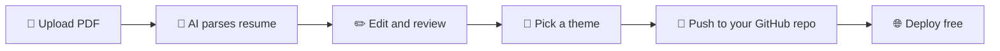

<div align="center">


# 2minfolio

### Drop your resume. Get a portfolio that's *live*.

Resume PDF → AI parsing → 12 themes → your own GitHub repo. In about **2 minutes**.

[](https://2minfolio.onrender.com)
[](https://www.python.org/)
[](https://flask.palletsprojects.com/)
[](https://groq.com/)
[](https://render.com/)

</div>

---

## ✨ What is it?

**2minfolio** turns a plain resume PDF into a ready-to-ship portfolio website. No design skills, no boilerplate, no templates to wrestle with. Upload, tweak, publish.

> Built for students and job-seekers who want a professional online presence **today**, not next weekend.

## 🚀 Features

| | Feature | Details |
|---|---|---|
| 📄 | **AI Resume Parsing** | Extracts name, skills, experience, projects, education and achievements from your PDF. Uses only facts in your resume, nothing invented. |
| 🧠 | **Honest Resume Review** | ATS / readability / impact score (0–100) plus 5–9 specific issues, each with a concrete fix. |
| ✏️ | **Editable Data Tables** | Fix anything the AI got wrong. The preview updates live. |
| 🎨 | **12 Themes** | Bento, brutalism, glass, hacker and more. Click to preview instantly. |
| 📱 | **Responsive Preview** | Check Desktop, Tablet and Mobile views before publishing. |
| 🐙 | **One-Click GitHub Publish** | Creates a fresh public repo in *your* account with `index.html`, `script.js` and `resume.pdf`. |
| ⚡ | **Instant Deploy** | Host the generated site free on GitHub Pages, Vercel or Netlify. |

## 🧭 How it works



1. **Upload** your resume PDF (and an optional photo)
2. **Review** the parsed data and the AI feedback
3. **Theme** it with a live preview
4. **Ship** it to a new repo and deploy

## 🛠️ Tech Stack

- **Backend:** Python, Flask, Gunicorn
- **AI:** Groq API (`openai/gpt-oss-20b`) with strict JSON output
- **PDF parsing:** pypdf
- **Auth and publishing:** GitHub OAuth + GitHub REST API
- **Frontend:** Vanilla HTML, CSS and JS (no framework, no build step)
- **Hosting:** Render

## 📁 Project Structure

```
2minfolio/
├── app.py              # Flask backend: OAuth, PDF parse, AI call, GitHub publish
├── static/
│   ├── index.html      # Landing page and workspace UI
│   ├── app.js          # UI logic
│   ├── builder.js      # Portfolio generator (12 themes)
│   └── favicon.svg
├── requirements.txt
├── Procfile
└── render.yaml         # One-click Render config
```

## ⚙️ Run Locally

```bash
git clone https://github.com/Krish033-source/2minfolio.git
cd 2minfolio
pip install -r requirements.txt
```

Create a GitHub OAuth App ([Settings → Developer settings → OAuth Apps](https://github.com/settings/developers)) with callback URL `http://localhost:5000/auth/callback`, then set:

```bash
export GITHUB_CLIENT_ID=your_client_id
export GITHUB_CLIENT_SECRET=your_client_secret
export GROQ_API_KEY=your_groq_key
export SECRET_KEY=any_random_string
export BASE_URL=http://localhost:5000

python app.py
```

Open **http://localhost:5000** 🎉

## ☁️ Deploy

This is a **Flask app, so it needs a server**. It will not run on GitHub Pages (static only).

1. Push this repo to GitHub
2. On [Render](https://render.com), create a **New → Blueprint** from the repo (`render.yaml` is included)
3. Add `GITHUB_CLIENT_ID`, `GITHUB_CLIENT_SECRET`, `GROQ_API_KEY`
4. Set your OAuth App callback to `https://<your-app>.onrender.com/auth/callback`

## 🔒 Privacy and Safety

- Requests only the `public_repo` scope
- Resumes are processed in memory and **not stored** on the server
- Generated code goes into **your** repo, you own everything

## ⚠️ Limitations

- Text-based PDFs only (scanned or image PDFs are not supported yet)
- Max upload size 25 MB
- Free Render tier sleeps when idle, so the first load can take ~30 seconds

## 🗺️ Roadmap

- [ ] OCR support for scanned resumes
- [ ] More themes
- [ ] Custom domain helper
- [ ] Export as ZIP

## 🤝 Contributing

Issues and PRs are welcome. Fork → branch → PR.

---

<div align="center">

Made with ☕ by [Krish033-source](https://github.com/Krish033-source)

⭐ **Star this repo if it saved you time!**

</div>
